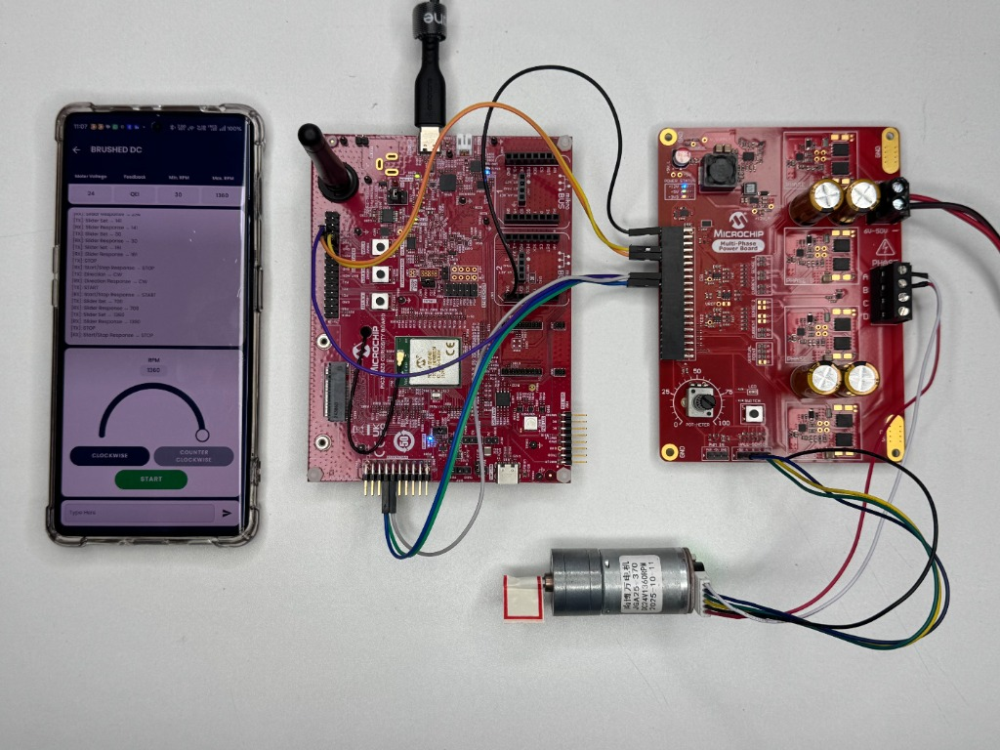
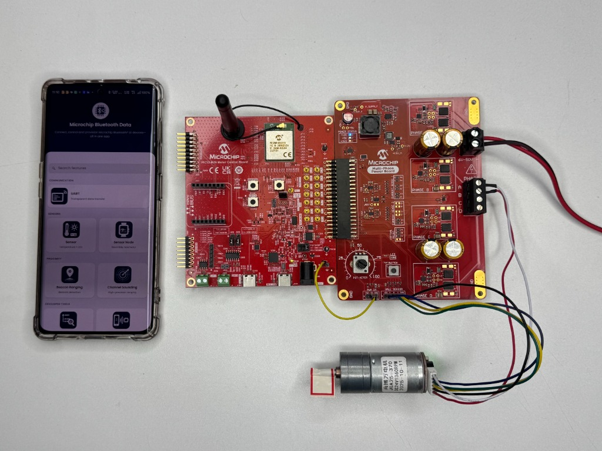
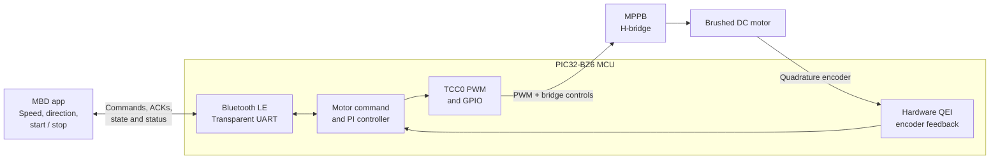
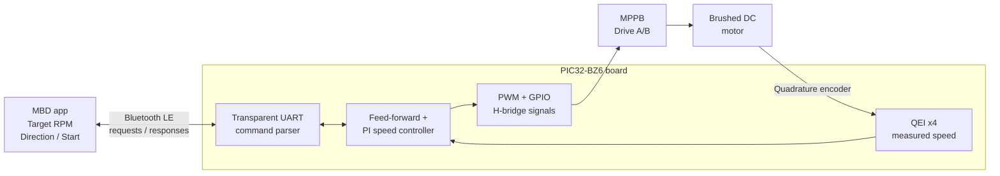
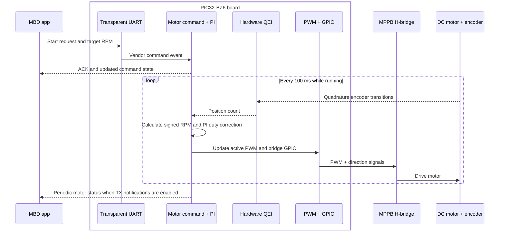

<div align="center">

<h1>Bluetooth® LE Brushed DC Motor QEI PI Control</h1>

<p><strong>Closed-loop motor speed control. Powered by Zephyr®.</strong></p>

<p>Wireless MCU &nbsp; | &nbsp; Bluetooth LE &nbsp; | &nbsp; QEI feedback &nbsp; | &nbsp; PWM + MPPB</p>

<p><a href="#31-prerequisites">Set up Zephyr</a> · <a href="#32-import-the-application">Import</a> · <a href="#34-build-the-application">Build</a> · <a href="#35-program-the-board">Flash</a> · <a href="#5-demo-setup-and-operation">Run with MBD</a></p>

</div>

**Contents**

1. [Introduction](#1-introduction)
2. [Hardware Setup](#2-hardware-setup)
3. [Zephyr Software Setup](#3-zephyr-software-setup)
   - [Prerequisites](#31-prerequisites)
   - [Import the application](#32-import-the-application)
   - [Application configuration](#33-application-configuration)
   - [Build](#34-build-the-application)
   - [Program](#35-program-the-board)
   - [File structure and adding board support](#36-file-structure-and-adding-board-support)
4. [Application Architecture and Control Principles](#4-application-architecture-and-control-principles)
   - [Control architecture](#41-control-architecture)
   - [Bluetooth LE data flow and commands](#42-bluetooth-le-data-flow-and-commands)
   - [PWM and motor control](#43-pwm-and-motor-control)
5. [Demo Setup and Operation](#5-demo-setup-and-operation)
6. [Validation and Troubleshooting](#6-validation-and-troubleshooting)


## 1. Introduction

Control a brushed DC motor wirelessly from the Microchip Bluetooth Data (MBD)
app. Bluetooth® LE speed and direction commands are translated into PWM and
GPIO signals for the Microchip Multi-Phase Power Board (MPPB). Hardware QEI
(Quadrature Encoder Interface) feedback and a PI controller adjust motor duty
to track the requested speed.

The same application supports the **PIC32-BZ6 Curiosity** and **BZ6 Motor
Control Board (MCB)**. Board overlays provide the power-stage pin mappings;
the application selects the corresponding encoder pin and QEI routing at
build time.

> **Example motor:** Zbotic GA25-370, 24 V, rated 1360 RPM. The configured
> slider range is 0–1360 RPM. QEI scaling is provisionally set to 194
> counts/output revolution; verify and calibrate it for your motor and encoder.

### Disclaimer

This example is provided **“AS IS”** as a starting point for development and
self-support. A speed request is not a guarantee of actual speed. Verify the
motor, encoder, power supply, MPPB and wiring ratings before use. Keep the motor
stopped while checking wiring, encoder phase and direction.

## 2. Hardware Setup

### Bill of materials

| Item | Quantity | Notes |
| :-- | :--: | :-- |
| PIC32-BZ6 Curiosity or BZ6 Motor Control Board | 1 | Supported Zephyr boards listed in [Board selection](#34-build-the-application) |
| Microchip MPPB (EV35Z86A) | 1 | Use Drive A and Drive B as one brushed-DC H-bridge; leave C/D unused |
| Brushed DC motor with quadrature encoder | 1 | Example: 24 V GA25-370; confirm encoder output type and voltage |
| Regulated motor supply | 1 | Set to the motor/MPPB rating; this example documents 24 V motor operation |
| USB cable and supported debugger | 1 | Debug probe and OpenOCD requirements depend on the board setup |
| Jumper wires | As needed | Curiosity uses jumpers for MPPB connections; MCB connects directly |

#### Requesting a BZ6 Motor Control Board

The BZ6 Motor Control Board is available by request rather than through the
Microchip product-page ordering flow. Complete the
[Motor Control Board request form](https://mkpage.microchip.com/get-your-development-board).
Submitted requests are sent to Microchip's CSS team for follow-up.

### Wiring

Connect the MPPB control header, motor, encoder and power supply with power
removed. **The motor power supply connects to the MPPB power input—not directly
to the motor.**

**PIC32-BZ6 Curiosity with MPPB**

<p align="center"></p>

**BZ6 Motor Control Board with MPPB**

<p align="center"></p>

| Function | MPPB connection | PIC32-BZ6 Curiosity | BZ6 Motor Control Board |
| :-- | :-- | :-- | :-- |
| Drive A High (PWM) | Pin 26 | PA7 / TCC0 WO0 | PA7 / TCC0 WO0 |
| Drive A Low (GPIO) | Pin 25 | PA3 | PA3 |
| Drive B High (PWM) | Pin 24 | PA1 / TCC0 WO1 | PA1 / TCC0 WO1 |
| Drive B Low (GPIO) | Pin 23 | PA0 | PA0 |
| Encoder A | Encoder output A | PB6 / QEI QEA, jumper wire | Pin 32 / PC9 (Hall C); routed to QEI QEB |
| Encoder B | Encoder output B | PB4 / QEI QEB, jumper wire | Pin 34 / PC8 (Hall B); routed to QEI QEA |
| Status LED | Board LED | PB7, active low | PE0, active low |
| Signal/power reference | MPPB GND | Connect board GND | Connect board GND |
| Motor supply | MPPB motor power input | External supply to MPPB | External supply to MPPB |
| Motor terminals | MPPB Drive A / Drive B | Motor leads to A and B | Motor leads to A and B |

The motor PWM and low-side pins are the same on both boards. **Curiosity uses
jumper wires** between its GPIO/PWM/encoder signals and the MPPB. The MCB plugs
directly into the MPPB connector. On MCB, the connector labels PC9/PC8 as Hall C
and Hall B; connect these to the two **quadrature encoder** outputs as shown.
Three-phase Hall feedback is not quadrature encoder feedback.

For MCB, the physical encoder signals are A on PC9/pin 32 and B on PC8/pin 34.
The PIC32 QEI peripheral routes PC8 to QEA and PC9 to QEB to preserve the
working direction **without enabling its internal A/B swap**. Curiosity uses
PB6 as QEA and PB4 as QEB. Keep the listed encoder wiring; do not swap the two
signals in addition to the configured pin routing.

MPPB pins 27/28/40 are grounds. Join control and motor-supply grounds as
required by the hardware setup. MPPB pins 18 (PWM IN), 21–22 (Drive C),
and 19–20 (Drive D) are not used by this application. The MCB's MPPB LED
connection (PD0, pin 33) is also unused; the firmware uses the board's onboard
PE0 LED.

> ⚠️ **Power and wiring safety**
>
> Verify the MPPB and motor datasheets for supply voltage, current and wiring
> requirements. Keep 24 V off MCU GPIO, encoder and PWM pins. Power the encoder
> only at its specified voltage; level-shift any signal that exceeds the MCU
> input rating. Use a common reference ground and keep Drive C/D disconnected
> for this brushed-DC configuration. A 95% PWM duty limit is not a hardware
> safety interlock.

The following diagram is a functional overview. Use the board-specific pin
table above for physical wiring.



## 3. Zephyr Software Setup

### 3.1 Prerequisites

Set up the Microchip Zephyr Wireless environment using either supported
workflow:

- **Workbench (VS Code):** [Workbench for Zephyr](https://github.com/Zephyr4Microchip/zephyr-wireless/blob/main/docs/Workbench_for_Zephyr.md)
- **Command line (CLI):** [Zephyr Wireless environment setup](https://github.com/Zephyr4Microchip/zephyr-wireless#2-environment-setup)

Use the Microchip Zephyr checkout and modules that provide the PIC32CX BZ6
SoC, BLE controller, QEI device headers and Transparent UART service/server.
Use the SDK version supported by that workspace. A generic upstream Zephyr
checkout does not provide all required Microchip components.

**Supported boards:**

- `pic32wm_bz6204_curiosity/pic32cx2051bz62132`
- `bz6_motor_control_board/pic32cx2051bz62132` (application-provided board)

#### Setup guide and supporting references

- [Microchip Workbench for Zephyr guide](https://github.com/Zephyr4Microchip/zephyr-wireless/blob/main/docs/Workbench_for_Zephyr.md) — environment, import, build, flash and programmer-mode setup.
- [Microchip Zephyr Wireless](https://github.com/Zephyr4Microchip/zephyr-wireless) — workspace, SDK and supported CLI workflow.
- [Zephyr PWM API](https://docs.zephyrproject.org/4.2.0/hardware/peripherals/pwm.html) — PWM API used by this application.
- PIC32CX2051BZ62132 device datasheet and MPPB EV35Z86A documentation — verify pin multiplexing and electrical ratings for the actual hardware revision.

### 3.2 Import the application

#### Clone into the workspace

For the Workbench workflow, clone from your Zephyr workspace's `applications`
directory:

```powershell
git clone https://github.com/MicrochipTech/Bluetooth_LE_Brushed_DC_Motor_QEI_PI_Control.git
```

The application repository contains the firmware and MCB board definition; it
does not contain Zephyr, Microchip HAL/modules, the SDK or programmer tools.

#### Workbench

Import the cloned application folder in Zephyr Workbench. The MCB board is
provided inside the application, so add the application root to
`zephyr-workbench.env.BOARD_ROOT` if it is not already discovered. For a
workspace opened at the Zephyr workspace root:

```json
"zephyr-workbench.env.BOARD_ROOT": [
    "${workspaceFolder}/applications/Bluetooth_LE_Brushed_DC_Motor_QEI_PI_Control"
]
```

If VS Code opens the application directory itself, use
`"${workspaceFolder}"`. Keep other board-root entries only if they define
different boards. Do not register both this repository and another copy of
`bz6_motor_control_board` (for example, the original development application):
Zephyr rejects duplicate board definitions. Reload the VS Code
window, choose **Change Board**, and select either supported board identifier.

#### CLI

No IDE import is required. For this CLI workflow, copy the application folder or
clone the repository inside the Zephyr checkout's `samples` directory. The build
commands below assume it is at
`~/zephyrproject/zephyr/samples/Bluetooth_LE_Brushed_DC_Motor_QEI_PI_Control`.

To clone it directly into that location:

```bash
cd ~/zephyrproject/zephyr/samples
git clone https://github.com/MicrochipTech/Bluetooth_LE_Brushed_DC_Motor_QEI_PI_Control.git
```

See the [Zephyr Wireless CLI workflow](https://github.com/Zephyr4Microchip/zephyr-wireless#legacy-command-line)
for workspace and shell setup.

### 3.3 Application configuration

The application uses Zephyr Kconfig for features, devicetree for board
peripherals and pin routing, the Zephyr PWM/GPIO APIs for the bridge, and the
PIC32 QEI peripheral for encoder feedback.

| Layer | Configuration / source | Role |
| :-- | :-- | :-- |
| Bluetooth LE and Transparent UART | [`prj.conf`](prj.conf), `src/trs*.c` | BLE peripheral, MBD transport, buffers and notifications |
| Board discovery | [`CMakeLists.txt`](CMakeLists.txt), `boards/microchip/bz6/` | Registers and defines the application-provided MCB board |
| Motor bridge pins | `boards/<board>.overlay` | MPPB aliases, GPIO outputs, PWM channels and board-specific pinmux |
| Encoder routing | [`src/plib_qei.c`](src/plib_qei.c), [`src/plib_qei.h`](src/plib_qei.h) | Configures QEI inputs and selects pins for each board |
| Motor commands and PI | [`src/app_dc_motor.c`](src/app_dc_motor.c), [`src/app_dc_motor.h`](src/app_dc_motor.h) | BLE command handling, QEI measurement, PI control and motor outputs |
| BLE/UART integration | [`src/main.c`](src/main.c) | Advertising, callbacks, status, LED indication and UART bridge |

The PI loop runs every 100 ms, limits duty to 3–95%, and limits duty changes to
1 percentage point per update. Current gains and the nominal 194
counts/output-revolution scale are starting values; tune and calibrate for the
actual motor/load. Full QEI diagnostics are optional through
`CONFIG_APP_DC_MOTOR_VERBOSE_QEI_LOG`.

### 3.4 Build the application

#### Workbench

Select one of the supported boards and the SDK configured by the Microchip
workspace. Use a **pristine build** when changing boards so the cached
devicetree and Kconfig settings are regenerated.

#### CLI

Refer to [Zephyr Wireless — Building sample applications](https://github.com/Zephyr4Microchip/zephyr-wireless#3-building-sample-applications).
As in the servo application, run the build from the Zephyr checkout directory,
using the application under `samples`.

For Curiosity:

```bash
cd ~/zephyrproject/zephyr
west build -p always -b pic32wm_bz6204_curiosity samples/Bluetooth_LE_Brushed_DC_Motor_QEI_PI_Control
```

Or, for the Motor Control Board:

```bash
cd ~/zephyrproject/zephyr
west build -p always -b bz6_motor_control_board samples/Bluetooth_LE_Brushed_DC_Motor_QEI_PI_Control
```

Zephyr automatically selects the matching
`boards/pic32wm_bz6204_curiosity.overlay` or
`boards/bz6_motor_control_board.overlay`. Run only the command for your board.
The output is generated under `~/zephyrproject/zephyr/build/`; `-p always`
regenerates that build directory when changing boards. No precompiled image
is required from this repository.

### 3.5 Program the board

#### Workbench

Use the Workbench flash action with the **OpenOCD** runner. Select the probe
supported by the board and make sure it is in programmer/debugger mode.

#### CLI

From the Zephyr checkout directory, flash the build produced in the previous
section:

```bash
cd ~/zephyrproject/zephyr
west flash
```

Connect the board matching the last build. A message such as
`unable to find a matching CMSIS-DAP device` means OpenOCD cannot see the
debug probe; check USB, probe selection/mode, drivers and any application
holding the probe. It does not indicate a firmware build or QEI error.

### 3.6 File structure and adding board support

```text
Bluetooth_LE_Brushed_DC_Motor_QEI_PI_Control/
|-- README.md
|-- CMakeLists.txt
|-- Kconfig
|-- prj.conf
|-- sample.yaml
|-- .gitignore
|-- boards/
|   |-- pic32wm_bz6204_curiosity.overlay
|   |-- bz6_motor_control_board.overlay
|   `-- microchip/bz6/bz6_motor_control_board/
|       |-- board.yml
|       |-- bz6_motor_control_board.dts
|       |-- bz6_motor_control_board-pinctrl.dtsi
|       |-- bz6_motor_control_board.yaml
|       |-- Kconfig*
|       |-- *defconfig
|       |-- board.cmake
|       `-- support/openocd.cfg
`-- src/
    |-- main.c
    |-- app_dc_motor.c / app_dc_motor.h
    |-- plib_qei.c / plib_qei.h / plib_qei_common.h
    `-- trs.c / trs.h / trs_server.c / trs_server.h
```

#### Adding another board

1. **Check the hardware first.** Record the MCU/SoC, MPPB power-stage
   connections, PWM-capable pins, GPIO pins, encoder A/B signals, LED and
   debugger. Check the SoC pin-multiplexing/PPS tables and board schematic.
2. **Add an application overlay** at `boards/<board>.overlay`. Define the
   `dc-motor-a-high-pwm`, `dc-motor-b-high-pwm`, `dc-motor-a-low`,
   `dc-motor-b-low` and `led3` aliases consumed by the application. Configure
   the PWM pinmux and disable peripherals that conflict with motor pins.
3. **Add a complete board definition** only if the selected Zephyr checkout
   does not already provide the board. Use
   `boards/microchip/bz6/bz6_motor_control_board/` as the PIC32-BZ6 reference.
   Adapt `board.yml`, board metadata YAML, Kconfig, defconfig, DTS, pinctrl,
   `board.cmake` and debugger support to the actual hardware; do not just
   rename files.
4. **Add QEI routing** in `src/plib_qei.h` and `src/plib_qei.c`. Confirm the
   legal QEA/QEB PPS routes, configure the correct GPIO port/pin and analog
   settings, and select the board-specific mapping explicitly. Verify CW is
   positive and CCW negative before running closed-loop PI. If reversing
   direction, change the input route or encoder wiring deliberately; do not
   assume Hall labels identify quadrature signals.
5. **Register and test board discovery.** For Workbench, add the application
   root to `zephyr-workbench.env.BOARD_ROOT` and reload the window. Verify
   with `west boards --board-root <application-root>`.
6. **Build and validate.** Build from pristine state, confirm the generated
   devicetree/aliases and pinmux, inspect PWM and encoder signals with
   appropriate test equipment, then test both directions at low speed before
   increasing load or target speed.

## 4. Application Architecture and Control Principles

### 4.1 Control architecture

| At a glance | Application behavior |
| :-- | :-- |
| Bluetooth LE advertising name | `Zephyr_DC_Motor` |
| BLE motor profile | `BRUSHED DC` / QEI feedback |
| Target speed | 0–1360 RPM; 0 stops/coasts |
| Direction | CW or CCW |
| PWM output | 1 kHz, TCC0 WO0/WO1 |
| Motor bridge | MPPB Drive A and B used as one H-bridge |
| Feedback | Hardware QEI quadrature encoder, x4 count mode |
| Control | Feed-forward plus PI, 100 ms update, 3–95% duty limits |
| Startup | Target defaults to 1360 RPM, but bridge remains stopped until START |

The diagram is generic: actual motor, encoder and MCU pins depend on the
selected board's hardware table.



### 4.2 Bluetooth LE data flow and commands

#### From a speed request to motor control



An ACK confirms that the command reached the application; it is not speed or
position feedback. The application measures speed using QEI. Status is sent
through Transparent UART after TX notifications are enabled.

#### Motor command packet format

The Bluetooth Control Point vendor frame uses hexadecimal bytes:

```text
 Byte 0      Byte 1          Byte 2       Bytes 3...
+---------+---------------+------------+-------------------+
| 8E      | LENGTH        | COMMAND ID | COMMAND DATA      |
+---------+---------------+------------+-------------------+
```

`LENGTH` is the number of bytes following the length field. Slider RPM is an
unsigned 16-bit big-endian value.

#### UI update response (`B1`)

```text
8E | LENGTH | B1 | NAME_LENGTH | NAME | FEEDBACK_LENGTH | FEEDBACK |
VOLTAGE_H L | MIN_RPM_H L | MAX_RPM_H L | SLIDER_H L | DIRECTION | START_STOP
```

Voltage, minimum RPM, maximum RPM and slider value are unsigned 16-bit
big-endian fields. Minimum RPM is configured by `DC_MOTOR_MIN_RPM` in
[`src/app_dc_motor.h`](src/app_dc_motor.h), currently **30 RPM** (`00 1E`).
The existing 0–1360 RPM command range is unchanged (zero stops the motor). This is not a
claim that every nonzero target is mechanically achievable.

After reset, the full response is:

```text
8E 1A B1 0A 42 52 55 53 48 45 44 20 44 43 03 51 45 49 00 18 00 1E 05 50 05 50 01 00
```

This reports `BRUSHED DC`, `QEI`, 24 V, minimum 30 RPM, maximum 1360 RPM,
slider 1360 RPM, CCW and STOP. `LENGTH` is **0x1A (26)** bytes after the
length field; the full frame is 28 bytes. Adding minimum RPM changes the
previous length of 0x18. For example, 50 RPM is encoded as `00 32`; the
minimum field is metadata, not a new low-speed clamp.

| Phone request | Example | ACK | Main response |
| :-- | :-- | :-- | :-- |
| Read UI/state | `8E 01 A1` | `8E 01 D1` | UI response `B1` |
| Set target to 200 RPM | `8E 03 A2 00 C8` | `8E 01 D2` | `8E 03 B2 00 C8` |
| Set direction to CW | `8E 02 A4 00` | `8E 01 D4` | Direction response `B4` |
| Set direction to CCW | `8E 02 A4 01` | `8E 01 D4` | Direction response `B4` |
| Stop motor | `8E 02 A5 00` | `8E 01 D5` | Start/stop response `B5` |
| Start motor | `8E 02 A5 01` | `8E 01 D5` | Start/stop response `B5` |

Setting target RPM to zero also stops/coasts the bridge. Direction changes stop
the motor; send START again to resume in the new direction.

| Characteristic | Phone action | Board action |
| :-- | :-- | :-- |
| Control Point (CP) | Write vendor frames; subscribe for responses | Executes `0x8E` motor commands; returns ACKs and state |
| RX data | Write transparent bytes | Forwards bytes to UART; does not execute motor commands |
| TX data | Subscribe to notifications | Delivers UART-originated and periodic status data |

Use the Control Point for motor commands, not the transparent UART RX
characteristic.

### 4.3 PWM and motor control

#### Direction and speed control

PWM frequency is **1 kHz** (1 ms period). The PI loop adjusts the active
high-side PWM duty based on target speed and direction-aware QEI feedback.
The opposite high-side output is held low; the selected low-side GPIO is
asserted for direction. At stop, both PWM outputs and both low-side GPIOs are
inactive, so the motor coasts.

| State | Active high-side PWM | Active low-side GPIO |
| :-- | :-- | :-- |
| Stop / target 0 | Both off | Both off |
| CW | Drive B High / PA1, PWM | Drive A Low / PA3 |
| CCW | Drive A High / PA7, PWM | Drive B Low / PA0 |

The table gives the MCU pins used by both supported boards. See [Hardware
Setup](#2-hardware-setup) for the corresponding MPPB connector pins.

The controller uses a 3% starting-duty floor and a 95% maximum, with a 1
percentage-point duty slew limit per 100 ms update. Its feed-forward map is
an initial estimate; PI corrects the difference between target and measured
speed. The configured 1360 RPM maximum does not guarantee 1360 RPM under load,
with a particular supply, or with a particular motor. PI gains and the 194
counts/revolution scale need validation and may require tuning.

The reported RPM is calculated from QEI position-count change and actual
elapsed time. Confirm encoder A/B routing and CW/CCW sign before enabling a
powered closed-loop test.

## 5. Demo Setup and Operation

The demo below shows wireless brushed-DC motor control using the MBD app,
the BZ6 Motor Control Board and MPPB.

https://github.com/user-attachments/assets/da585c05-47aa-4363-b3d4-f5811bb2753b

1. Check all MPPB, encoder and motor connections against the table. Leave motor
   power off until the encoder direction has been checked.
2. Build for the connected board and program the firmware. After reset, the
   application advertises as **`Zephyr_DC_Motor`**; the motor remains stopped.
3. Open the MBD app, scan and connect to the board. Open the brushed-DC motor
   controls and enable Control Point notifications if the app does not do so
   automatically.
4. Select direction, enter a low target RPM, and send START. The application
   acknowledges the command and updates PWM as QEI reports speed.
5. Check serial output for `target_rpm`, `calculated_rpm`, duty and signed
   velocity. Increase target/load only after encoder direction and the low
   speed response are correct.
6. Send STOP or set RPM to zero before disconnecting or changing wiring.

For a manual Bluetooth LE client, enable Control Point notifications before
sending commands. Use hexadecimal byte writes. A 200 RPM slider request is
`8E 03 A2 00 C8`; START is `8E 02 A5 01`. Generic writes to Transparent UART
RX are forwarded to UART and do not execute motor commands.

## 6. Validation and Troubleshooting

Both board configurations are intended to build from the same application
source. Verify actual operation on the connected hardware; compilation alone
does not validate the board wiring, encoder phase or achievable motor speed.

| Check | Expected result |
| :-- | :-- |
| Board startup | Correct board build; motor outputs inactive |
| QEI hand-turn test | Position changes; CW signed velocity is positive and CCW negative |
| Encoder scale | Compare x4 counts against independently marked output-shaft turns |
| PWM | 1 kHz on the active high-side pin; the other PWM channel is inactive |
| Direction | CW uses B High/A Low; CCW uses A High/B Low |
| Speed loop | Measured RPM trends toward target without duty continuing to rise during overspeed |
| Stop | Both bridge legs inactive and motor coasts |

| Symptom | Check |
| :-- | :-- |
| Board missing from Workbench | Add the application root to `zephyr-workbench.env.BOARD_ROOT`, then reload the window |
| `west boards` cannot find MCB | Use `west boards --board-root <application-root>`; confirm the complete board directory is present |
| Motor RPM rises above target while duty keeps increasing | Stop the motor. Check QEI pin routing, A/B phase, CW/CCW sign, selected board and pristine rebuild |
| QEI count remains zero | Confirm the selected board, encoder signal wiring, common ground, input pin configuration and QEI PPS route |
| Correct speed in one direction only | Verify that both encoder phases toggle and signed velocity has opposite signs in CW/CCW |
| RPM differs from an independent tachometer | Calibrate counts/output revolution over multiple marked shaft turns and verify elapsed-time/count measurement |
| Speed does not reach target | Check motor/supply/load limits, 95% duty ceiling, MPPB voltage drop and measured QEI feedback |
| Motor does not run | Verify START state, nonzero target, GPIO/PWM readiness, active direction and MPPB supply |
| OpenOCD cannot find CMSIS-DAP | Check USB connection, probe programmer/debugger mode, driver and probe ownership; this is separate from build/QEI |
| MBD connects but motor commands have no effect | Write commands to Control Point, enable notifications, and check received vendor-command logs |

> ⚠️ **Before powered testing**
>
> First hand-turn the shaft with motor power disconnected. Confirm changing QEI
> counts, positive CW and negative CCW velocity, and plausible counts per
> output-shaft turn. If feedback has the wrong sign, STOP and correct the wiring
> or board-specific QEI route before running closed-loop PI. Begin at a low RPM
> with the motor mechanically secured and clear of moving parts.
